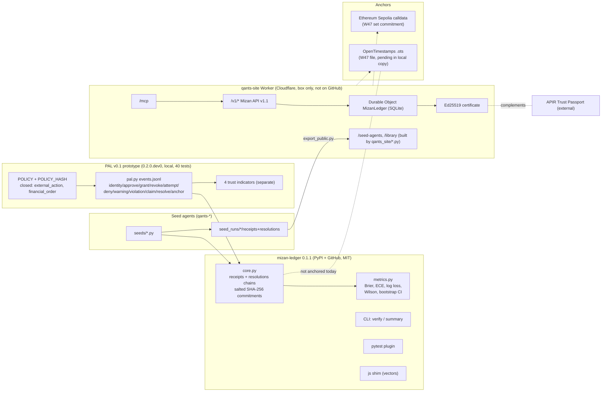

# QANTS Agent Trust Lab, PR 1: Architecture map (what exists now)

Audit date: 17 Nov 2026, 07:34 GMT+2. Read-only inspection. Nothing was modified, pushed or deployed.
Every figure below cites the file or URL it was read from. "Unknown" means it was not verified in this audit.

## 1. Components

### 1.1 `mizan-ledger` 0.1.1 (published library)
| Item | Value | Evidence |
|---|---|---|
| Version on PyPI | 0.1.1 (releases: 0.1.0, 0.1.1) | `https://pypi.org/pypi/mizan-ledger/json`, read 17 Nov 2026 |
| Source | `github.com/Allanoo99/mizan-ledger`, default branch `main`, MIT, last push 16 Nov 2026 23:40 GMT+2 | GitHub REST `repos/Allanoo99/mizan-ledger`, read 17 Nov 2026 |
| CI | No `.github/` directory in the repo (contents API returns 404); README says "No CI workflow file is included" | GitHub contents API; `/workspace/mizan-ledger/README.md` |
| Local checkout | `/workspace/mizan-ledger` (not a git working copy locally: `git log` fails) | shell check |
| Code size | core 247 lines, metrics 111, pytest plugin 81, CLI 22, trace adapter 41 | `wc -l /workspace/mizan-ledger/src/mizan_ledger/*.py` |
| Tests | 22 passed (16 core + 6 adapters) | `python3 -m pytest -q` in `/workspace/mizan-ledger` |
| Record schema | `mizan-ledger/1` | `src/mizan_ledger/core.py` `SCHEMA` |
| JS shim | `js/mizan-ledger.mjs` (commitment, declare, verify opening only; no file ledger) | `README.md` adapters table |
| Shared vectors | `vectors/commitments.json` (Python and JS check the same vectors) | `README.md` |

How it works (`core.py`):
- `declare()` writes a hash-only public receipt: `{schema, seq, agent_id, agent_version, commitment, declared_at, prev, receipt_hash}`. The opening `{task_id, p, salt}` goes to a private file (mode 600).
- Commitment = `SHA-256(canonical_json({agent_id, agent_version, p (6-dp string), salt (128-bit), schema, task_id}))`.
- `resolve()` reveals the opening, scores it, and appends to a second chain (`record_hash`).
- `verify_ledger_dir()` is offline: chain links, seq, openings vs commitments, resolved-after-declared, scores.
- Metrics (`metrics.py`): Brier, log loss (clip [0.01, 0.99]), ECE (10 bins), reliability table, accuracy + Wilson 95%, bootstrap 95% interval for Brier (2000 reps, fixed seed).
- Timestamps are the local clock (stated in `core.py` docstring and README "Guarantees and honest limits").

### 1.2 PAL v0.1 prototype (unpublished)
| Item | Value | Evidence |
|---|---|---|
| Location | `/workspace/mizan-ledger-pal` (a copy of mizan-ledger plus PAL) | `diff -rq` vs `/workspace/mizan-ledger` |
| Version | `0.2.0.dev0`, not published | `pyproject.toml`; PyPI shows only 0.1.0, 0.1.1 |
| New code | `src/mizan_ledger/pal.py` (452 lines), `tests/test_pal.py` (16 test functions), `examples/pal_demo.py`, `demo_runs/pal_options_lab_DEMO` | `wc -l`, `ls` |
| Tests | 40 passed (22 inherited + 18 PAL test items after parametrisation) | `python3 -m pytest -q` in `/workspace/mizan-ledger-pal` |
| Schema / policy ids | `mizan-pal/0.1`, `mizan-pal-policy/0.1.1` | `pal.py` `PAL_SCHEMA`, `POLICY` |
| Spec | `/workspace/qants_dossier/agent_source/PAL_spec_v0.1.md` | file |

What PAL already provides:
- One append-only, hash-chained `events.jsonl` with event types `identity, approve, grant, revoke, attempt, deny, warning, violation, claim, resolve, anchor` (`pal.py` `EVENT_TYPES`).
- Levels `analysis / signal / execution`. `external_action` and `financial_order` are permanently closed. `modify_files` and `exec_commands` are default-deny and grantable only with `human_explicit` approval plus an allowlist (`pal.py` `POLICY`).
- `POLICY_HASH` stamped on every event; a verifier with a different policy reports a mismatch.
- Every claim embeds `permission_state_hash` at decision time (this is the founder's `permission_snapshot`).
- Not-granted attempt: `deny` plus `warning` with a required non-empty note. Closed permission: `deny` plus critical `violation`.
- `verify_pal()` replays every decision offline (`pal.py` line 309).
- Four trust indicators, never combined: Prediction Accuracy, Permission Compliance, Transparency, Historical Reliability (`trust_indicators()`, spec §6).
- `anchor` event with status `pending / verified / failed` (`pal.py` line 296). No OTS client call is wired in; the status is supplied by the caller.
- CLI: `mizan-ledger pal verify <dir>` and `mizan-ledger pal record <dir> --agent ID` (`src/mizan_ledger/cli.py`).

### 1.3 Seed agents (`qants-` prefix)
Live page https://qants-site.qants.workers.dev/seed-agents (read by curl, 17 Nov 2026 07:34 GMT+2):

| Agent | Declared | Resolved | Pending | Brier (95% interval) | ECE | Best constant guess Brier | Receipt chain head (prefix) |
|---|---|---|---|---|---|---|---|
| `qants-seed-codetask` v0.1.0 | 60 | 60 | 0 | 0.173 [0.118, 0.231] | 0.069 | 0.170 | `4f536ea7bc8a3119…` |
| `qants-seed-apifetch` v0.1.0 | 50 | 50 | 0 | 0.084 [0.061, 0.111] | 0.209 | 0.160 | `5941cd3086a2858e…` |
| `qants-seed-countrypairs` v0.1.0 | 60 | 59 | 1 | 0.124 [0.084, 0.169] | 0.140 | 0.238 | `4334a14e445b6fce…` |
| **Total** | **170** | **169** | 1 | | | | |

The live page also says: 3 seed agents, "0 of them external", seeds never use the production API, and seed ids use the reserved `qants-` prefix.

Cross-check: `mizan-ledger verify seed_runs/<agent>` on the local copy returned `ok: true`, 0 errors, with the same counts and the same chain-head prefixes (run 17 Nov 2026 07:34 GMT+2). `public/data/seed_agents.json` says `generated_at 2026-11-16T15:23:57Z` (16 Nov 17:23 GMT+2), 3 agents, 170 declarations, 169 resolved.
Note: the codetask seed's best-constant Brier (0.170) is lower than its own Brier (0.173), so it does not beat the baseline. The page states this rule itself.

Code: `seeds/seed_*.py`, `seeds/common.py`, `seeds/export_public.py`. Raw ledgers in `seed_runs/qants-seed-*/{receipts,resolutions,events}.jsonl`. `events.jsonl` there is a free-form probe log, not hash-chained and not a PAL log.

### 1.4 Site worker on Cloudflare (code NOT on GitHub)
| Item | Value | Evidence |
|---|---|---|
| Worker | `qants-site`, https://qants-site.qants.workers.dev | `/workspace/qants_site_worker/README.md`, `wrangler.toml` |
| Code location | box only: `/workspace/qants_site_worker/src` (26 files, 9,248 lines), pages generated by `/workspace/qants_site/*.py` | `wc -l src/*` |
| Version control | none on GitHub; README says "Do not git push" | README |
| Storage | SQLite Durable Objects `MizanLedger` (tables `api_keys, agents, predictions, pool_resolutions, rl`) and `TryLedger`; KV namespaces for directory, Diwan, arena | `src/mizan-ledger.js` line 127-141, `wrangler.toml` |
| Public API in use | `/v1/status, /v1/keys, /v1/check, /v1/questions, /v1/passport/{id}, /v1/pool*, /v1/weekly*, /v1/compass, /v1/certificate*`; operator-only `/v1/resolve, /v1/daily/*, /v1/admin/*` | `src/mizan-api.js` lines 437-512, `src/certificate.js` |
| Not in use yet | `/v1/agents/*`, `/v1/events/*`, `/v1/verify/*` (no match in `src/`) | grep over `src/` |
| MCP | `/mcp`, `/.well-known/mcp.json`, tools incl. `mizan_check`, `mizan_get_passport`, `mizan_certificate` | `src/mcp.js`, `public/llms.txt` |
| Hosted SDK | `public/sdk/mizan.py` (stdlib client: status, issue_key, check, passport, badge_url), `public/sdk/mizan.ts` | files |
| Internal/external rule | `isQantsOperated()`: exact ids `qants-hybrid`, `qants-blockchain-first-principles`, prefixes `mztest-`, `qants-`. Code comment: "a name rule, not proof of operator" | `src/mizan-core.js` lines 17-25 |
| Certificate | Ed25519 calibration certificate, key id `mizan-cert-2026-11`, issuance operator-only | README "Mizan Calibration Certificate" |
| Safety key | `mizan-safety-2026-11`, status "preview", `safety_checks_issued: 0` | `src/safety-key.js` |

### 1.5 Anchors and timestamp proofs
- **Ethereum Sepolia (testnet).** Example: the 2026-W47 calibration-check set commitment `c4edc723…` was written as calldata in a zero-value self-transfer, tx `0xe35f5921…07acc`, block 12132674 (`public/cc/2026-W47/anchor_receipt.json`). tQNT and payroll contracts are also on Sepolia (`public/llms.txt` lines 76-101, `public/erc8004_registration.json`).
- **OpenTimestamps (Bitcoin calendars).** Already used once: `public/cc/2026-W47/commitments.json.ots`. Running `ots info` offline on the local copy shows 4 `PendingAttestation` entries (alice, bob, catallaxy, eternitywall calendars) and **no Bitcoin block attestation** in the local file. Whether the proof is upgradeable now: unknown (not run; it needs network calls to the calendars).
- The `/labs/time-proof-receipts` page describes OTS-on-Bitcoin receipts as a product (`public/labs-time-proof-receipts.html`).
- mizan-ledger and PAL ledgers themselves are **not anchored** anywhere today. Their timestamps are local-clock only (`core.py` docstring; PAL spec §7).

### 1.6 APIR and seals
- APIR Trust Passport is an external identity/mandate credential (`https://apir.ai/registry`). QANTS cites it as complementary to the Mizan certificate, not a replacement (`public/llms.txt` line 38; `/workspace/qants_dossier/agent_source/safety_attestation_design_2026-11-16.md` §1). Whether the QANTS APIR passport is searchable in the registry is unknown (open carried-over task).
- "Seals" in QANTS: (a) Ed25519 calibration certificate, (b) safety attestation in preview (prototype `/workspace/mizan-safety/`, 7 tests per its design doc, specimens only), (c) options-lab ledger seals (`/workspace/options_lab/SCHEMA.md`: `seq / prev_hash / line_hash` chain plus a `.head` file).

### 1.7 Options lab (paper only, tQNT)
`/workspace/options_lab/SCHEMA.md`: agents `qants-opt-momentum | qants-opt-shortvol | qants-opt-meanrev`, schema_version "1", method `pp-v2`. Hash chain uses `prev_hash`/`line_hash` with `ensure_ascii=True`, which differs from mizan-ledger/PAL (`prev`/`receipt_hash|event_hash`, `ensure_ascii=False`). Paper trading is Signal level in PAL.

## 2. Diagram

## 3. Compatibility constraints found
1. Three hash-chain dialects exist (mizan-ledger/1, mizan-pal/0.1, options lab v1). A v1.1 event layer must not re-hash or rewrite any of them.
2. The production `/v1/` namespace is already live and public. New Trust Lab routes must not change any existing route's behaviour.
3. The site worker is not under version control on GitHub. A "feature branch + PR" workflow applies only to `mizan-ledger`. Worker changes need the founder's deploy approval in chat and a backup/rollback file, as before.
4. `POST /v1/keys` refuses only the `mztest-` prefix for public callers (`src/mizan-ledger.js` line 174). It does **not** refuse `qants-`. An outside caller could claim a `qants-*` id, and `isQantsOperated()` would then count it as internal. This was a gap (see THREAT_MODEL T-S2). **Update 17 Nov 2026 07:45 GMT+2:** fixed in production with the founder's approval. Public `POST /v1/keys` now returns `400 reserved_agent_id` for ids that, after trim and lowercase, start with `mztest-` or `qants-` or match an exact QANTS id (worker version `22e3bb66-476d-49e8-bb97-2efb80ff4824`).
